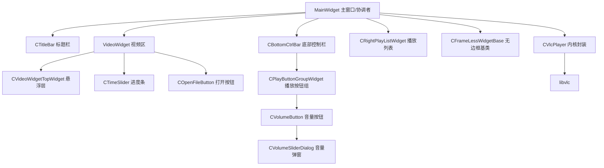
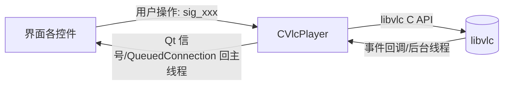

# QWMediaPlayer

基于 **Qt 6 + libvlc** 的桌面视频播放器，参考 QQ 影音的界面与交互，采用无边框窗口，实现视频播放、进度拖动、播放列表、音量调节、窗口置顶、迷你模式等功能。

## 功能特性

- 无边框自定义窗口：标题栏拖动、边缘 8 方向缩放、Aero Snap、双击最大化
- 视频区悬浮控制层：鼠标进入显示按钮、离开隐藏，双击画面全屏
- 时间进度条：拖动跳转、点击槽身"点哪跳哪"、淡入淡出
- 播放列表：添加文件/文件夹、双击切播、右键移除、去重、数量状态同步
- 播放控制：播放/暂停、停止、上一个/下一个、顺序播放、音量与静音
- 窗口置顶、迷你模式、记住上次打开目录（QSettings 写注册表）

## 技术栈与开发环境

| 项 | 内容 |
|---|---|
| 语言标准 | C++11 |
| GUI 框架 | Qt 6.8.3（msvc2022_64 套件） |
| 播放内核 | libvlc 3.0.8（随工程目录提供） |
| 开发工具 | Visual Studio 2022（.sln 工程） |
| 样式方案 | QSS 集中管理（qss.h） |

## 目录结构

```
QWMediaPlayer/
├─ QWMediaPlayer.sln            # VS 解决方案
├─ README.md                    # 本说明文件
├─ x64/                         # 构建输出（Debug/Release）
└─ QWMediaPlayer/               # 源码目录
   ├─ main.cpp                  # 程序入口
   ├─ MainWidget.h/.cpp         # 主窗口（协调者，负责接线）
   ├─ CFrameLessWidgetBase.h/.cpp   # 无边框窗口基类（边缘缩放/光标）
   ├─ CTitleBar.h/.cpp          # 自定义标题栏
   ├─ VideoWidget.h/.cpp        # 视频区容器
   ├─ CVideoWidgetTopWidget.h/.cpp  # 视频画面悬浮层
   ├─ CTimeSlider.h/.cpp        # 时间进度条
   ├─ CBottomCtrlBar.h/.cpp     # 底部控制栏
   ├─ CPlayButtonGroupWidget.h/.cpp # 播放按钮组
   ├─ COpenFileButton.h/.cpp    # “打开文件”胶囊按钮
   ├─ CVolumeButton.h/.cpp      # 音量按钮
   ├─ CVolumeSliderDialog.h/.cpp# 音量滑块弹窗
   ├─ CRightPlayListWidget.h/.cpp # 右侧播放列表
   ├─ CVlcPlayer.h/.cpp         # libvlc 内核封装
   ├─ AppConfig.h               # 应用配置常量
   ├─ qss.h                     # 全局 QSS 样式集中管理
   ├─ QWMediaPlayer.qrc         # Qt 资源文件（图标）
   ├─ resources/                # SVG 图标资源
   └─ vlc-3.0.8-win64/          # libvlc 运行时与 SDK
```

## 模块与文件职责

### 入口与主窗口

| 文件 | 职责 |
|---|---|
| main.cpp | 创建 QApplication 与主窗口，进入事件循环 |
| MainWidget | 协调者：组装各界面模块，创建内核并连接双向信号，处理窗口级动作，本身只"接线" |

### 窗口框架

| 文件 | 职责 |
|---|---|
| CFrameLessWidgetBase | 无边框窗口基类：应用级事件过滤器实现边缘 `startSystemResize` 与缩放光标 |
| CTitleBar | 自定义标题栏：logo、置顶、最小化、最大化/还原、关闭，拖动与双击；通过信号外发不直接操作窗口 |

### 视频区

| 文件 | 职责 |
|---|---|
| VideoWidget | 视频区容器：组装画面容器、悬浮层、独立进度条，转发各类信号 |
| CVideoWidgetTopWidget | 画面悬浮层：透明常驻，进入显示/离开隐藏按钮，保证双击始终命中 |
| CTimeSlider | 进度条：事件过滤器实现点击槽身按比例跳转，拖动发信号 |
| COpenFileButton | 打开文件/文件夹胶囊按钮，弹选择对话框并外发结果 |

### 底部控制

| 文件 | 职责 |
|---|---|
| CBottomCtrlBar | 底部控制栏：时间标签、播放按钮组、工具/全屏按钮 |
| CPlayButtonGroupWidget | 停止/上一个/播放暂停/下一个/音量按钮组，仅通过信号通知 |
| CVolumeButton | 音量按钮：悬停弹窗、左键切换静音，定时器判断离开区域 |
| CVolumeSliderDialog | 音量滑块弹窗：ToolTip 风格、无边框、失焦自动关闭 |

### 播放列表与内核

| 文件 | 职责 |
|---|---|
| CRightPlayListWidget | 右侧播放列表：增删、去重、右键菜单、双击切播、状态同步 |
| CVlcPlayer | libvlc 封装：把 C 接口转成 Qt 信号，静态回调切回主线程，界面与 libvlc 解耦 |
| AppConfig.h | 应用配置常量（如 QSettings 注册表路径） |
| qss.h | 全局 QSS 样式，按模块划分子命名空间，集中换肤 |

## 架构分层与模块关系



## 数据流向（界面 ↔ 内核）

界面层不感知 libvlc，内核层不感知具体控件，全部通过 Qt 信号通信：



- 界面 → 内核：点击、拖动等操作发信号，CVlcPlayer 调用 libvlc 接口
- 内核 → 界面：libvlc 后台线程事件先到 CVlcPlayer，再经信号（跨线程自动 QueuedConnection）回主线程更新界面

## 构建与运行

1. 用 Visual Studio 2022 打开 `QWMediaPlayer.sln`。
2. libvlc 已随工程放在 `QWMediaPlayer/vlc-3.0.8-win64`，工程已用相对路径配置：
   - 包含目录：`vlc-3.0.8-win64/sdk/include`
   - 库目录：`vlc-3.0.8-win64/sdk/lib`
   - 链接库：`libvlc.lib`、`libvlccore.lib`
3. 运行时需要 `libvlc.dll`、`libvlccore.dll` 以及 `plugins` 目录（输出目录已含两个 DLL；如换机器需把运行时放到可执行文件旁或配置工作目录）。
4. 选择 `x64` 的 Debug 或 Release，构建并运行。

## 关键设计约定

- **高内聚低耦合**：界面模块只发信号，CVlcPlayer 统一封装 libvlc，MainWidget 只负责接线
- **头文件轻量化**：libvlc 仅在 .cpp 包含，头文件用不透明类型前置声明，界面层不引入 libvlc
- **样式集中**：所有 QSS 收纳于 qss.h，按模块划分，图标走 .qrc 资源
- **线程安全**：libvlc 回调在后台线程，跨线程信号用 QueuedConnection 切回主线程再操作 UI/定时器

## 维护说明

本文件只记录相对稳定的架构、职责与构建方式；若后续新增/删除模块或调整结构，请同步更新“目录结构”“文件职责”和架构图，避免文档与代码脱节。
