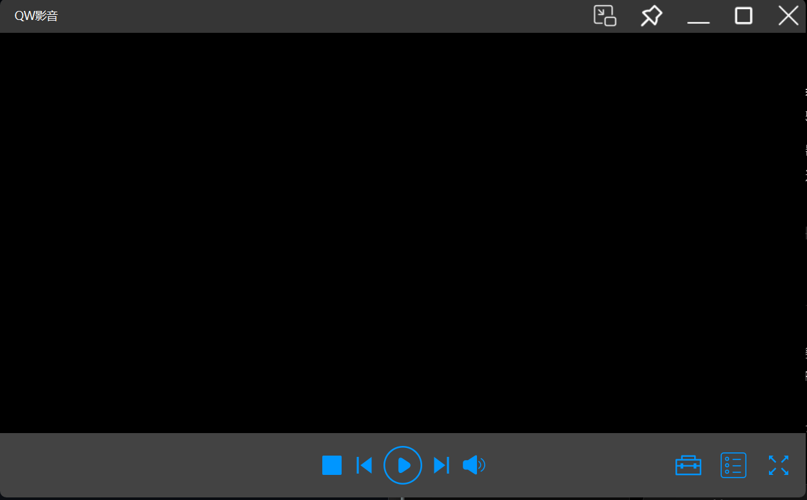
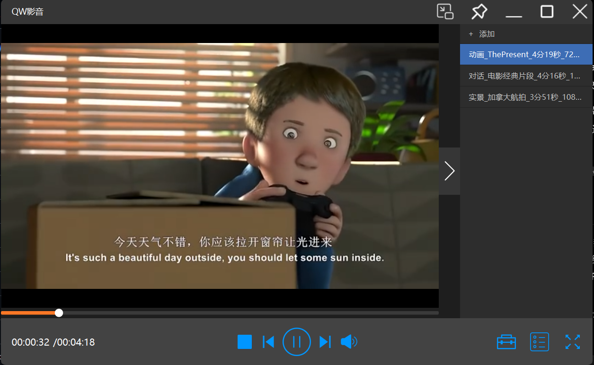
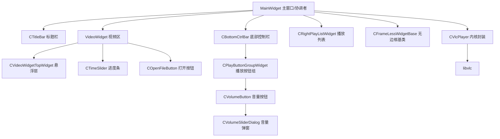

# QWMediaPlayer

基于 Qt 6 + libVLC 的 Windows 桌面视频播放器。无边框窗口、视频区悬浮控制层、播放列表、迷你模式，界面与交互参考 QQ 影音。

<p align="center">
  
  
</p>

## 功能

- 无边框自定义窗口：标题栏拖动、8 方向边缘缩放、Aero Snap、双击最大化
- 视频区悬浮控制层：鼠标移入显示按钮、移出隐藏，双击画面全屏
- 进度条：拖动跳转、点击槽身按比例跳转、淡入淡出
- 播放列表：添加文件/文件夹、双击切播、右键移除、去重
- 播放控制：播放/暂停、停止、上一个/下一个、顺序播放、音量与静音
- 窗口置顶、迷你模式、记住上次打开目录（QSettings 写注册表）

## 技术栈

| 项 | 内容 |
|---|---|
| 语言 | C++11 |
| GUI | Qt 6.8.3（MSVC 2022 64-bit 套件） |
| 播放内核 | libVLC 3.0.8 |
| 工程 | Visual Studio 2022（.sln） |
| 样式 | QSS 集中管理（qss.h） |

## 构建

### 环境要求

- Windows 10/11
- Visual Studio 2022（勾选"使用 C++ 的桌面开发"工作负载）
- Qt 6.8.3，MSVC 2022 64-bit 套件
- libVLC 3.0.x（仓库不含 VLC 二进制文件，需自行获取，见下）

### 1. 获取 libVLC

从 [VLC 官网](https://www.videolan.org/vlc/) 下载 Windows 64 位版（本项目使用 3.0.8，3.0.x 系列均可）。解压（或从 VLC 安装目录）取出以下内容，放到源码目录下 `QWMediaPlayer/vlc-3.0.8-win64/`：

```
vlc-3.0.8-win64/
├─ sdk/            # include 与 lib，编译用
├─ plugins/        # 运行时插件目录
├─ libvlc.dll      # 运行时
└─ libvlccore.dll  # 运行时
```

> 从 VLC 安装目录复制时，`sdk` 在安装目录下，`plugins` 和两个 dll 直接复制即可。

### 2. 编译

1. 用 Visual Studio 2022 打开 `QWMediaPlayer.sln`
2. 平台选 `x64`，配置选 `Debug` 或 `Release`
3. 直接生成。生成后事件会自动把 `libvlc.dll`、`libvlccore.dll`、`plugins` 复制到输出目录（`x64/Debug` 或 `x64/Release`）

运行输出目录中的 `QWMediaPlayer.exe` 即可。

## 打包发布

Release 构建后，用 Qt 自带的 windeployqt 收集 Qt 依赖（在输出目录下执行）：

```
"<Qt安装目录>\6.8.3\msvc2022_64\bin\windeployqt.exe" --release --compiler-runtime QWMediaPlayer.exe
```

生成后事件已把 VLC 运行时复制到输出目录，打包时把 `plugins` 目录一并带上。若目标机器缺 MSVC 运行库，将 `MSVCP140.dll`、`VCRUNTIME140.dll`、`VCRUNTIME140_1.dll` 放到 exe 旁即可。

## 项目结构

```
QWMediaPlayer/
├─ QWMediaPlayer.sln            # VS 解决方案
├─ screenshots/                 # 本文档截图
└─ QWMediaPlayer/               # 源码目录
   ├─ main.cpp                  # 入口
   ├─ MainWidget.h/.cpp         # 主窗口：模块组装与信号接线
   ├─ CFrameLessWidgetBase.*    # 无边框窗口基类（边缘缩放/光标）
   ├─ CTitleBar.*               # 自定义标题栏
   ├─ VideoWidget.*             # 视频区容器
   ├─ CVideoWidgetTopWidget.*   # 画面悬浮层
   ├─ CTimeSlider.*             # 时间进度条
   ├─ CBottomCtrlBar.*          # 底部控制栏
   ├─ CPlayButtonGroupWidget.*  # 播放按钮组
   ├─ COpenFileButton.*         # 打开文件胶囊按钮
   ├─ CVolumeButton.*           # 音量按钮
   ├─ CVolumeSliderDialog.*     # 音量滑块弹窗
   ├─ CRightPlayListWidget.*    # 右侧播放列表
   ├─ CVlcPlayer.h/.cpp         # libVLC 封装：C 接口转 Qt 信号
   ├─ AppConfig.h               # 配置常量
   ├─ qss.h                     # 全局 QSS
   ├─ QWMediaPlayer.qrc         # 资源文件（图标）
   ├─ resources/                # SVG 图标
   └─ vlc-3.0.8-win64/          # libVLC SDK 与运行时（需自行获取，见"构建"）
```

## 架构



界面控件不直接调用 libVLC：控件发信号给 CVlcPlayer，由它调用 C 接口；libVLC 的事件回调在后台线程，经 Qt 信号（QueuedConnection）切回主线程再更新界面。libvlc 头文件只在 .cpp 中包含，界面层不感知 libVLC。

## 许可证

- libVLC：[LGPL-2.1](https://www.videolan.org/legal.html)，动态链接使用，未修改其源码
- 本项目：MIT License
